# Caseware template publish fan-out worker

This Caseware Staff Java take-home demonstrates how to plan a template publication across eligible engagements, resume from a durable PostgreSQL checkpoint and execute the jobs under a shared downstream capacity limit. It uses **Java 25**, **Spring Boot 4.1.2**, the **Maven 3.9.16 Wrapper** and **PostgreSQL 18.6** for local integration tests and the executable demo.

## Caseware feedback and verified results

**Start with the [test evidence guide](docs/evidence/README.md).** It links each feedback point to the implementation, the scenario that verifies it and the remaining regional acceptance work. The evidence below comes from commit `b80c148` on `main`.

| Feedback | What the tests demonstrate | Report |
| --- | --- | --- |
| **Capacity was process-local.** | Two independent JVMs share one PostgreSQL admission pool. With a configured limit of **1**, the downstream measures a peak of **1**, including while an attempt has an unresolved outcome. | [Worker integration results](https://github.com/luisfm44/caseware-template-fanout-worker/actions/runs/43134129499/artifacts/13905974454) |
| **There was no scheduling across firms.** | With two slots occupied by a large firm, the small firm gets the next free slot while **30** large-firm jobs are still ready. The peak stays at **2**. | [Worker integration results](https://github.com/luisfm44/caseware-template-fanout-worker/actions/runs/43134129499/artifacts/13905974454) · [Scenario assertions](docs/worker-architecture.md#verification) |
| **The job consumer was missing.** | The `postgres-worker` profile leases persisted jobs. After the first JVM is killed, the surviving JVM reconciles the original attempt. The downstream records **one effect per operation** and both jobs reach `APPLIED`. | [Worker integration results](https://github.com/luisfm44/caseware-template-fanout-worker/actions/runs/43134129499/artifacts/13905974454) |
| **Version rules and summary checks lacked automated tests.** | Two Spring Boot reference APIs run over real loopback HTTP. **13** scenarios verify version offers and application state. **15** scenarios verify artifact hashes, net changes, promotion, rules fallback and the original receipt. | [Version-selection HTML](https://github.com/luisfm44/caseware-template-fanout-worker/actions/runs/43134129446/artifacts/13906906514) · [Summary-validation HTML](https://github.com/luisfm44/caseware-template-fanout-worker/actions/runs/43134129467/artifacts/13907106040) |

**Snapshot recovery** also has a cross-process test. A fresh planner JVM resumes from the stored snapshot ID and cursor after the source changes. An expired or mismatched snapshot halts planning. The worker baseline has **48 unit and 29 PostgreSQL integration tests**, with **100% JaCoCo line and branch coverage** and a passing **SonarQube Quality Gate**. [Worker tests](https://github.com/luisfm44/caseware-template-fanout-worker/actions/runs/43134129499/artifacts/13905974454) · [Quality reports](https://github.com/luisfm44/caseware-template-fanout-worker/actions/runs/43134129499/artifacts/13906113674)

**Regional acceptance remains open.** The owners of the regional updates API and summary service need to run equivalent suites in their own CI. The proposed SQS deployment and integration with the owning engagement manager need regional verification. [Owner acceptance](docs/owner-acceptance.md) · [Regional rollout verification](docs/regional-verification.md)

## Developer documentation

- [GitHub Wiki Home](https://github.com/luisfm44/caseware-template-fanout-worker/wiki) and [Getting Started](https://github.com/luisfm44/caseware-template-fanout-worker/wiki/Getting-Started) explain how to build, test and run the demo.
- [Contributor Workflow on the Wiki](https://github.com/luisfm44/caseware-template-fanout-worker/wiki/Contributor-Workflow) and the [versioned contributor guide](docs/contributing.md) explain issue creation, branch names and pull requests.
- [Code Quality and CI on the Wiki](https://github.com/luisfm44/caseware-template-fanout-worker/wiki/Code-Quality-and-CI), [pipeline reference](docs/pipelines.md) and [SonarQube guide](docs/code-quality.md) explain validation and how to find reports.
- [Architecture on the Wiki](https://github.com/luisfm44/caseware-template-fanout-worker/wiki/Architecture) covers the runnable application and the proposed regional system.

## Architecture

### Runnable Java application

Planning pins a source snapshot and commits each page of jobs with its checkpoint in PostgreSQL. A resumed planner reads the stored snapshot ID and cursor. The `demo` profile exercises two logical workers in one JVM. The `postgres-worker` profile consumes planned jobs durably and shares a downstream capacity pool between JVMs through PostgreSQL.

<!-- Image exported from the Mermaid diagram in docs/worker-architecture.md. -->


[Distributed crash-test sequence](docs/worker-architecture.md#process-loss-test-sequence) · [Worker design decisions](docs/worker-design.md)

See the [Java package structure](docs/worker-architecture.md#package-structure) for the application services, contracts, adapters and Spring Boot entry points.

### Proposed regional system

The system proposal places the worker in a regional background verification flow alongside the template catalog, regional updates API, summary service and engagement manager. The system guide shows which services own the offer, summary artifact, admission and downstream outcome. It also traces the two reference APIs from their controlled fixtures to their observed results. [System architecture](docs/system-architecture.md)

<!-- Image exported from the Mermaid diagram in docs/system-architecture.md. -->


The PDF contains the original design on pages 1–6 and an updated implementation and test appendix. The AWS workbook models the proposed rollout with editable volume and rate assumptions. [Architecture PDF](docs/architecture.pdf) · [AWS cost model](docs/aws-cost-model.xlsx)

## Run locally

Use JDK 25. The checked-in Apache Maven Wrapper downloads Maven 3.9.16 on its first run and verifies the distribution checksum. Spring Boot 4.1.2 provides the application entry point.

```sh
./mvnw --version
./mvnw -DfailIfNoTests=true verify
```

Windows users can use `mvnw.cmd`. Packaging produces `target/template-fanout-worker.jar`.

### PostgreSQL integration tests and executable demo

From a clean checkout with JDK 25 and Docker Compose, start the PostgreSQL 18.6 service in [`compose.yaml`](compose.yaml), run the tests and launch the packaged demo.

```sh
export FANOUT_DB_PASSWORD='your-local-password'
docker compose up -d --wait
./mvnw -Ppostgres-integration -DfailIfNoTests=true verify
java -jar target/template-fanout-worker.jar --spring.profiles.active=demo --demo.report=target/fanout-demo.json
cat target/fanout-demo.json
docker compose down
```

Compose binds PostgreSQL to `127.0.0.1:55432` and keeps its data in a named volume. Reuse the same password when restarting with that volume. The default Maven build runs the unit tests. The `postgres-integration` profile adds PostgreSQL tests for resume, replay, rollback and snapshot recovery across JVMs with a controlled source. The demo uses a disposable schema and removes it after the run.

If macOS file metadata interferes with a build on an external drive, add `-Dfanout.build.directory=/private/tmp/caseware-fanout-target` to the Maven command and use that directory in the `java -jar` path.

The sample publication has seven synthetic engagements and a page size of two. A fresh planner resumes after the first committed page. Two logical workers then execute the persisted job IDs under a shared limit of three. The downstream records one effect and drops its reply. The worker looks up the result with the same operation ID and completes that job without resubmitting it.

| Report field | Expected | Meaning |
| --- | ---: | --- |
| `plannedPages` | 4 | Pages committed to PostgreSQL after planning and resume |
| `submitted` | 7 | Persisted jobs submitted for worker execution |
| `completed` | 7 | Jobs that reached confirmed success |
| `appliedEffects` | 7 | Effects recorded by the simulated downstream |
| `duplicateEffects` | 0 | Effects applied again for a previously applied operation ID |
| `limit` | 3 | Shared admission capacity |
| `peakInFlight` | 3 | Peak simultaneous operations observed by the downstream |
| `dispatchAttempts` | 7 | Calls to submit work to the downstream |
| `reconciliations` | 1 | Status lookups after an ambiguous reply |

The demo measures shared capacity within one JVM. Its simulator keeps the effect ledger in memory and its retry budget applies to one worker execution.

### Durable worker and process recovery

With PostgreSQL running, execute the cross-process regression.

```sh
./mvnw -Ppostgres-integration -Dit.test=DurableWorkerProcessIT,PublicationSnapshotIT verify
```

The worker process suite seeds planned jobs, starts two independent JVMs against one HTTP test downstream, kills the first JVM and checks durable recovery, one effect per operation and a measured peak of one. Separate scenarios verify late confirmation before and after claim takeover, late-request fencing, stale revision rejection and cross-firm scheduling. The snapshot suite starts a fresh planner JVM against the persisted checkpoint after the controlled HTTP source changes. [Test setup and assertions](docs/evidence/README.md#reproduce-the-postgresql-tests)

To run a worker against a compatible downstream, first initialize the schema and insert jobs using the planner. Set `FANOUT_DB_URL`, `FANOUT_DB_USER`, `FANOUT_DB_PASSWORD` and `FANOUT_DOWNSTREAM_URL`.

```sh
java -jar target/template-fanout-worker.jar --spring.profiles.active=postgres-worker --worker.capacity=3
```

All replicas for a pool use the same PostgreSQL schema, configured capacity and downstream. The [worker design](docs/worker-design.md#durable-consumption-and-shared-capacity) specifies the HTTP contract and the regional integration responsibilities.

### Regional version selection E2E tests

Use JDK 25 and run this command from the repository root. The mockup starts a local Spring Boot HTTP server and exercises version offers against a controlled catalog and engagement manager.

```sh
./mvnw -f examples/regional-version-selection/pom.xml -DfailIfNoTests=true clean test
```

The GitHub Actions workflow uploads `regional-version-selection-e2e` for each completed suite that produces test results. Download the artifact, extract it and open `evidence/index.html` to inspect the HTTP exchanges for each scenario.

[Verified HTML report](https://github.com/luisfm44/caseware-template-fanout-worker/actions/runs/43134129446/artifacts/13906906514) · [GitHub Actions history](https://github.com/luisfm44/caseware-template-fanout-worker/actions/workflows/regional-version-selection.yml) · [Local report instructions](examples/regional-version-selection/README.md) · [Scenario screenshots](docs/evidence/issue-26/README.md)

### Summary validation E2E tests

With JDK 25, run the reference summary API's HTTP tests from the repository root.

```sh
./mvnw -f examples/summary-validation/pom.xml -DfailIfNoTests=true clean test
```

The suite uses approved template fixtures and a controlled grouping provider to check the net changes, fallback, editorial review and original view receipt. In GitHub Actions, download `summary-validation-e2e` and open `evidence/index.html` in the extracted archive to see the scenario results.

[Verified HTML report](https://github.com/luisfm44/caseware-template-fanout-worker/actions/runs/43134129467/artifacts/13907106040) · [GitHub Actions history](https://github.com/luisfm44/caseware-template-fanout-worker/actions/workflows/summary-validation.yml) · [Local report instructions](examples/summary-validation/README.md) · [Owner-side acceptance criteria](docs/owner-acceptance.md#summary-service)

## GitHub Actions

- **Verify and scan** runs on pull requests, pushes to main, or manual dispatch. The `verify` job runs the unit and PostgreSQL integration tests, packages the executable JAR, and uploads both sets of test reports. The `security` job scans dependencies and tracked sources with Trivy. High or critical findings fail the scan.
- **SonarQube quality** runs on pushes to `main` and on manual dispatch within **Verify and scan**. It combines unit and PostgreSQL test coverage, requires full JaCoCo line and branch coverage and enforces a 100% overall SonarQube Quality Gate. [Run and inspect code quality checks](docs/code-quality.md)
- **Run local deployment demo** is a manual smoke workflow on an isolated runner. It starts a PostgreSQL service, builds the JAR and launches the demo profile. The workflow checks the report for successful completion, single effects, shared capacity, resumed planning and reconciliation, then uploads the JSON report as an artifact. [Demo workflow](.github/workflows/demo.yml)

Worker Java changes must keep **100% line and branch coverage in JaCoCo** and pass the **100% overall SonarQube Quality Gate**. Worker PRs run `verify` and `security` automatically. Run **Verify and scan** manually on the PR branch to record the SonarQube result for worker Java changes. Each reference API has its own path-triggered HTTP workflow and report. [Pipeline event matrix and troubleshooting](docs/pipelines.md)

## Issues, branches and pull requests

Create an issue with acceptance criteria and track it in the [Caseware GitHub Project](https://github.com/users/luisfm44/projects/2). Choose a branch prefix for the type of work, such as `feature/issue-2-resumable-fanout`, `test/issue-12-full-coverage` or `docs/issue-9-developer-wiki`. Start from the latest `main` and open a draft PR targeting `main`. Use `Closes #N` for an issue the PR completes and `Refs #N` for evidence that contributes to an open acceptance item.

The board moves through **Todo → In Progress → Test → Done**. Record test and review evidence in **Test**. After squash merge, confirm the issue is closed, the card is in **Done** and its **Linked pull requests** field shows the merged PR. [Full contributor workflow](docs/contributing.md)

## AI assistance and human judgment

I used ChatGPT and Codex to compare implementation options and draft Java code, tests, CI configuration and documentation. During Issue #2, Codex initially proposed H2 for the durable checkpoint store. I asked to use PostgreSQL in Docker. The implementation used PostgreSQL transactions, a named development volume and integration tests against PostgreSQL in CI.

Production decisions still require human judgment. These include choosing who owns shared admission across processes, deciding what downstream evidence is authoritative after a timeout and weighing the capacity cost of retaining a permit while the outcome is unknown.

## Implementation checkpoints

1. [Two workers share admission to the downstream service](https://github.com/luisfm44/caseware-template-fanout-worker/issues/1). Instrument the fake service to count peak simultaneous calls.
2. [Page through engagements and resume the fan-out after a crash](https://github.com/luisfm44/caseware-template-fanout-worker/issues/2). Replaying a publication preserves job identity.
3. [Lose the response after a successful downstream effect](https://github.com/luisfm44/caseware-template-fanout-worker/issues/3). Retry with the same operation key or reconcile the recorded outcome.
4. [Verify the executable artifact and record implementation tradeoffs and the actual use of AI in this README](https://github.com/luisfm44/caseware-template-fanout-worker/issues/4).
5. [Integrate SonarQube](https://github.com/luisfm44/caseware-template-fanout-worker/issues/8) and [reach full Java test coverage](https://github.com/luisfm44/caseware-template-fanout-worker/issues/12).
6. [Publish the contributor and reviewer Wiki](https://github.com/luisfm44/caseware-template-fanout-worker/issues/9).
