# Template publish fan-out worker

Caseware Staff Java take-home. The worker starts operations for a template publication across engagements using a shared downstream capacity pool. The first checkpoint exercises two workers in one JVM against a simulated downstream.

## Worker architecture

Two logical workers share one admission controller and one simulated downstream in the Issue #1 tests. The controller admits up to three concurrent operations across both workers. If a caller times out, its operation keeps the slot until the downstream confirms it has ended.

<!-- Image exported from the Mermaid diagram in docs/worker-architecture.md. -->


[Worker components and operation lifecycle](docs/worker-architecture.md) · [System architecture and diagrams](docs/architecture.pdf) · [AWS cost model with editable assumptions](docs/aws-cost-model.xlsx)

## Run locally

Use JDK 25. The checked-in Apache Maven Wrapper downloads Maven 3.9.16 on its first run and verifies the distribution checksum. Spring Boot 4.1.2 provides the application entry point.

```sh
./mvnw --version
./mvnw -DfailIfNoTests=true verify
```

Windows users can use `mvnw.cmd`. Packaging produces `target/template-fanout-worker.jar`.

## GitHub Actions

- **Verify and scan** runs on pull requests, pushes to main, or manual dispatch. It validates the Maven project, reports the scaffold status, and scans dependencies and tracked sources with Trivy. High or critical findings fail the scan. As soon as Java sources exist, the workflow also requires tests, packages the executable JAR, and uploads it with the test reports.
- **Run local deployment demo** is a manual smoke workflow on an isolated runner. It requires the implemented worker, builds the JAR and launches its demo profile against a simulated downstream. The profile must write a JSON report to the file supplied through `--demo.report`. The workflow checks that every submitted engagement completed, no side effect was duplicated, and peak concurrency respected the configured limit. A missing report or implementation fails the run.

## Implementation checkpoints

1. [Two workers share admission to the downstream service](https://github.com/luisfm44/caseware-template-fanout-worker/issues/1). Instrument the fake service to count peak simultaneous calls.
2. [Page through engagements and resume the fan-out after a crash](https://github.com/luisfm44/caseware-template-fanout-worker/issues/2). Replaying a publication preserves job identity.
3. [Lose the response after a successful downstream effect](https://github.com/luisfm44/caseware-template-fanout-worker/issues/3). Retry with the same operation key or reconcile the recorded outcome.
4. [Verify the executable artifact and record implementation tradeoffs and the actual use of AI in this README](https://github.com/luisfm44/caseware-template-fanout-worker/issues/4).
