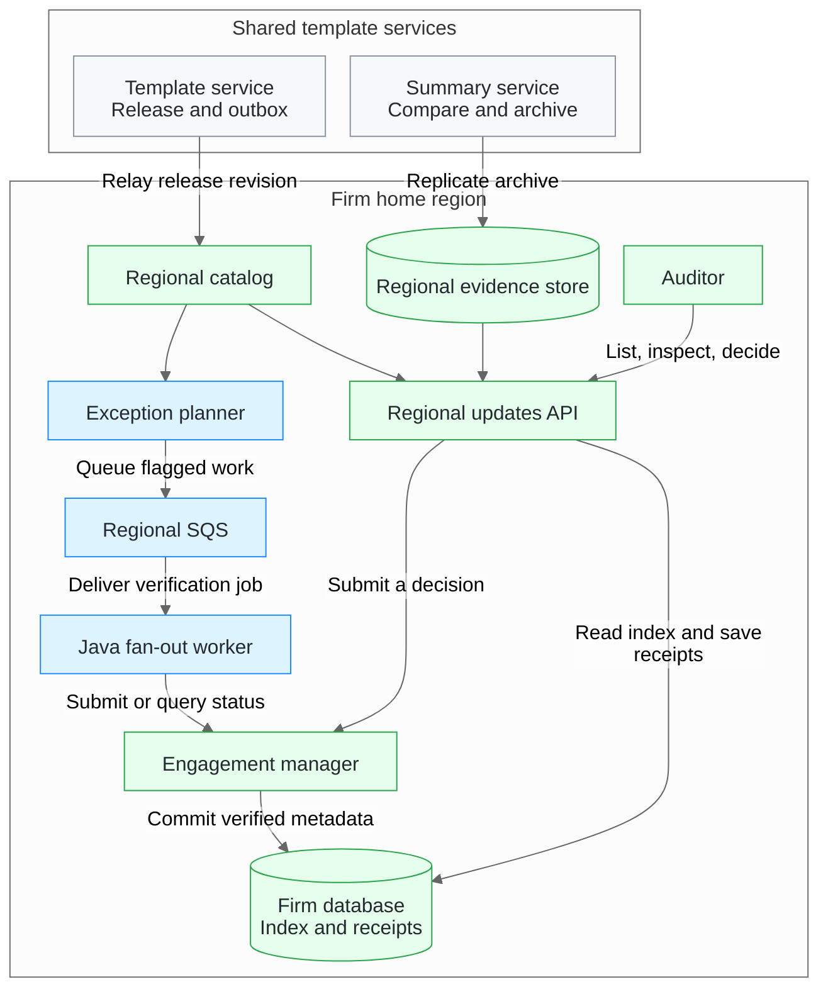

# Proposed regional system architecture

The proposal distributes template releases once per product and market, then resolves each auditor's update offer from verified metadata in the firm's home region. The Java fan-out worker is the background verification component in this design. The [runnable Java demo](worker-architecture.md) exercises its planning, admission and recovery contracts with PostgreSQL and a simulated downstream.

## Ownership and data flow

| Area | Proposed responsibility |
| --- | --- |
| Template service and regional catalog | Commit the release and outbox revision in one transaction. Regional consumers ignore older revisions and fetch a catalog snapshot on gaps. |
| Regional updates API | Derive firm and file access from the authenticated session. Use the active release, the verified effective version and prior decisions to determine which update to offer. Link each displayed summary to its archived text and a view receipt. |
| Summary and evidence | Compare exact approved template versions. Archive reviewed summary text and replicate it to regional evidence stores. The shared summary service uses template facts. |
| Engagement manager | Own file creation, opening and decisions. Check the expected file revision before writing verified metadata. The template authority orders decision admission against withdrawal. |
| Background verification | Plan jobs only for unknown or flagged baselines. Use the same operation ID for delivery retries and status lookups. Acknowledge the SQS message after durable completion. |

Before regional deployment, verify that the engagement source can reopen a publication's pinned snapshot from a fresh worker process and preserve its membership, order, revisions and cursor semantics until planning completes. [Worker snapshot contract](worker-design.md#engagement-snapshots)

The firm's home region keeps workpapers, decisions, receipts, queues, logs, keys and backups. Template data and opaque admission tokens can cross regions. The engagement manager's API is the boundary for workpaper access.

For background loads, the engagement manager holds a shared slot until completion or enforced cancellation. The proposal's **20 owner slots** are a sizing assumption to validate. The local demo uses **three permits within one JVM**. A regional deployment needs durable job claiming, a production transport adapter and a capacity authority shared by worker processes.

[System proposal and implementation appendix](architecture.pdf) · [Worker design decisions](worker-design.md) · [AWS cost model](aws-cost-model.xlsx)
