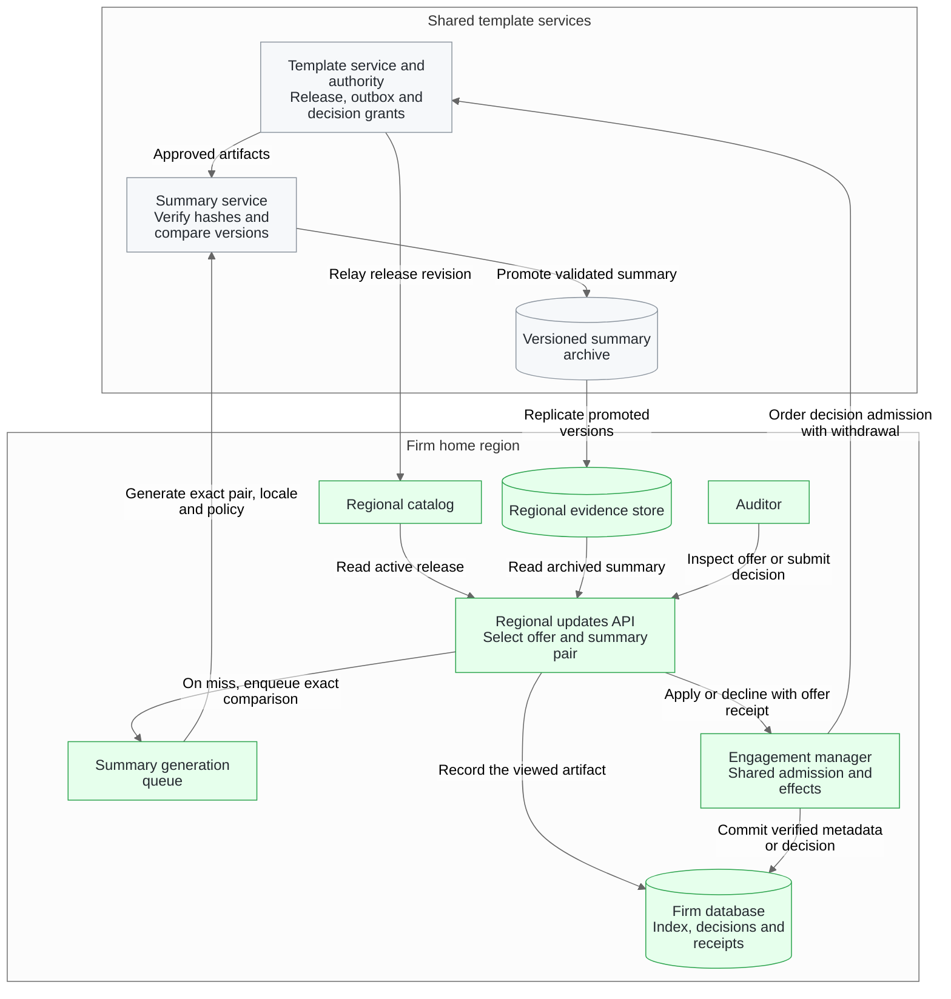
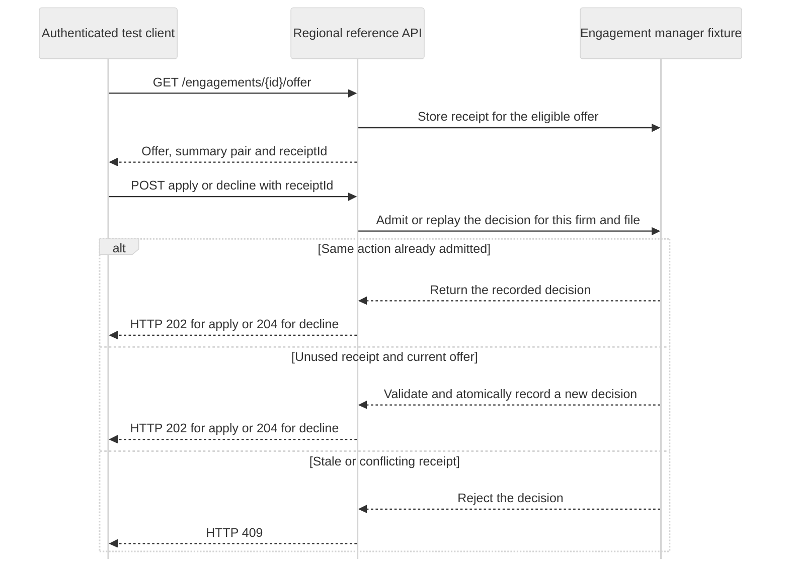
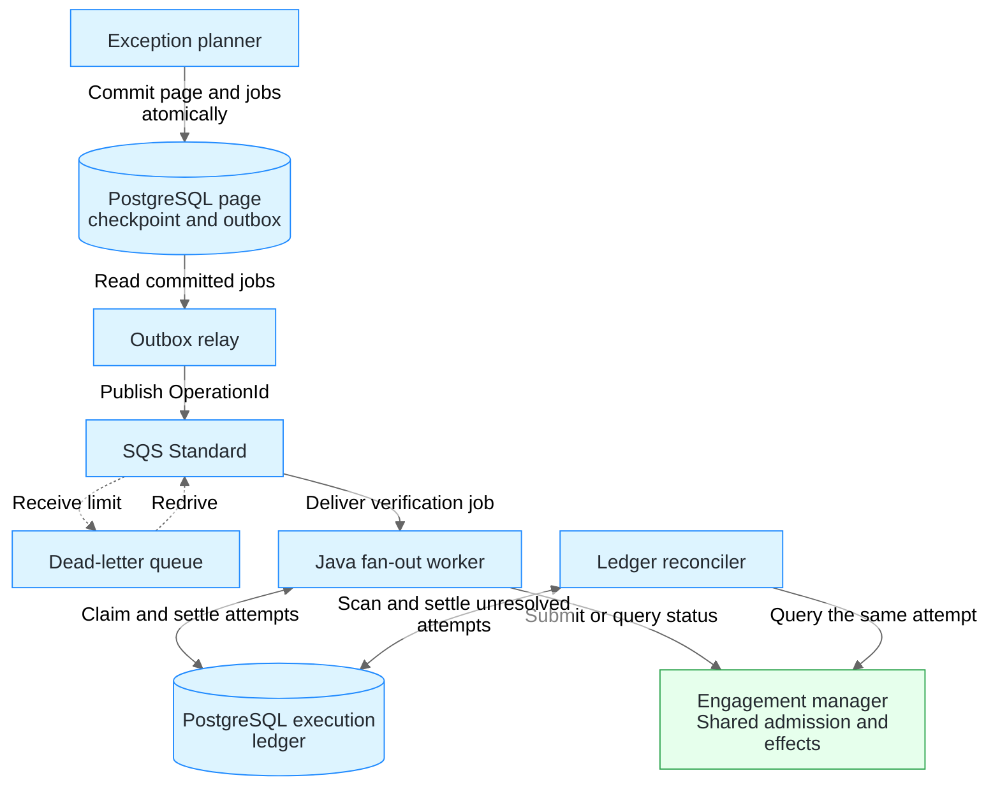

# Regional system architecture

The proposed deployment publishes template releases per product and market. The regional updates API derives each auditor's offer from verified metadata in the firm's home region. The Java fan-out worker covers background verification for unknown or flagged baselines. Template publication, summary generation, offer decisions and authoritative engagement changes belong to their respective services. [Regional deployment design](https://github.com/luisfm44/caseware-template-fanout-worker/issues/20)

The diagrams show the proposed service boundaries. This repository implements the Java worker and two local reference APIs. The worker's PostgreSQL and HTTP integration and the connected offer-to-summary flow have executable test evidence. [Java worker architecture](worker-architecture.md) · [Test evidence index](evidence/README.md)

## Service ownership in the proposed deployment

| Area | Proposed responsibility |
| --- | --- |
| Template service and regional catalog | Commit the release and outbox revision in one transaction. Regional consumers ignore older revisions and fetch a catalog snapshot on gaps. |
| Regional updates API | Derive firm and file access from the authenticated session. Use the active release, the verified effective version and prior decisions to select the offer and exact summary pair. Return an offer receipt for the apply or decline decision. Read the archived version for the exact comparison. On a miss, show **Preparing summary** and enqueue one request per product, track, baseline hash, target hash, locale and policy version. Record the archived summary version and locale shown to the auditor in a separate view receipt. |
| Summary service and regional evidence | Use approved template artifacts to verify the comparison, render a localized summary and archive each promoted version with its source hashes. Replicate promoted versions to regional evidence stores so the regional API can retrieve the version cited by a receipt. |
| Engagement manager | Own file creation, opening and decisions. Validate the original offer before admitting a new decision and replay an accepted decision idempotently. The manager asks the template authority to order new decision admission with withdrawal. An earlier withdrawal rejects new admission. An earlier admission can complete while its grant is valid and the expected file revision still matches. Enforce admission for the actual downstream pool, validate the expected engagement revision, deduplicate effects and provide authoritative status. |
| Regional exception planner | Plan jobs for unknown or flagged baselines against the publication's pinned engagement snapshot. Commit each page and its outbox records in the same transaction. |
| Regional Java worker | Claim deliveries in a durable execution ledger, reserve authorizations against the attempt budget, reconcile uncertain outcomes and acknowledge SQS after committing a terminal result. The engagement manager admits work against the shared downstream limit. |

## Reference APIs and evidence

| Repository entry point | Verified behavior | Regional acceptance |
| --- | --- | --- |
| [Regional version selection](../examples/regional-version-selection/README.md) | HTTP scenarios cover the offer and summary pair, receipt validation and decision replay, withdrawals, apply outcomes and firm isolation. | Validate the deployed offer, authorization and engagement contracts. |
| [Summary validation](../examples/summary-validation/README.md) | HTTP scenarios cover byte-hash validation, exact changes, grouping rejection and fallback, editor review and localized receipt replay. | Validate the deployed artifact store, renderer and durable archive. The reference API keeps its archive and receipts in memory. |
| [Connected reference APIs](../examples/connected-reference-apis/README.md) | A test driver forwards the offered pair, checks the exact localized artifact and its pinned receipt, skips summary generation when there is no offer, and observes rejection of changed bytes. | Validate the deployed service-to-service contract and recover the original receipt after process restarts. |

Both reference APIs start a local HTTP server with synthetic fixtures. In the connected suite, the test driver reads the regional offer and sends its comparison pair to the summary reference API. This is a local test flow. Regional deployment acceptance has its own criteria. [Connected mock sequence](../examples/connected-reference-apis/README.md#connected-reference-apis) · [Reports and screenshots](evidence/README.md) · [Regional acceptance criteria](owner-acceptance.md)

### Offer receipt and decision replay in the regional reference API

For an eligible offer on a file visible to the authenticated firm, the reference API returns an opaque `receiptId` with the offered pair. The engagement manager fixture binds it to the firm, file, engagement revision, catalog revision and exact baseline and target. It validates and records a new decision under the same lock used for catalog publication. A repeat of an admitted action returns the recorded decision.

The offer receipt identifies the original offer evaluated for the decision. The summary view receipt pins the localized artifact shown to the auditor. The local fixtures keep their records in memory. [Offer API contract](../examples/regional-version-selection/README.md#make-a-decision-with-the-original-receipt) · [Regional acceptance criteria](owner-acceptance.md#regional-updates-api)

### Summary generation and receipt replay

1. Resolve the approved baseline and target and verify the SHA-256 hash of each exact byte stream before parsing it. A mismatched artifact stops generation before grouping or promotion.
2. Compare the two verified versions directly. Record each net change by stable ID, JSON Pointer, operation and typed before/after values. An edit introduced in an intermediate release and reversed by the target leaves no net change.
3. Render every material change with approved wording for the requested locale. An unsupported material edit sends the comparison to editor review and holds promotion. In the fixtures, C17 changes inventory sign-off from optional to required. C18 adds the exception-reason field. That edit establishes field presence only.
4. When optional grouping is available, accept only the allowed grouping structure with every verified ID exactly once under a permitted topic. Grouping changes the order and topics of the approved sentences. An invalid or unavailable grouping keeps an existing verified artifact or promotes the complete rules summary when the pair and locale have no previous artifact.
5. Archive each promoted version with the exact hashes, localized sentences and their change facts. Bind a view receipt to the summary version shown. Resolving the receipt returns the original version and locale after a later version is promoted. The reference API exercises this against an in-memory archive. Production persistence and regional replication belong to the service owners.

## Dispatch by environment

| Environment | Dispatch | State and capacity |
| --- | --- | --- |
| Local exercise | PostgreSQL job table polled by the `postgres-worker` profile. | The same schema holds planning checkpoints, durable claims and the shared admission cursor and reservations. Two-JVM tests use a controlled HTTP downstream. |
| Proposed regional deployment | Amazon SQS Standard in each firm's home region, with a same-region dead-letter queue (DLQ). The worker long-polls SQS with bounded prefetch. | A regional PostgreSQL database holds the producer outbox and worker execution ledger. Use existing regional PostgreSQL or Amazon RDS for PostgreSQL if managed hosting is needed. The engagement manager owns the hard limit for its downstream pool. ECS on Fargate can run and replace worker replicas. |

The regional worker receives new work from SQS. Its ledger stores ownership and execution state. A recovery task scans the ledger for unresolved attempts, including work whose delivery reached the DLQ. It can resolve existing attempts independently of delivery. New attempts for DLQ work require redrive. The PostgreSQL polling path for fresh jobs belongs to the exercise. A regional SQS consumer and the real manager adapter are deployment work. [Amazon RDS for PostgreSQL](https://docs.aws.amazon.com/AmazonRDS/latest/UserGuide/CHAP_PostgreSQL.html) · [Amazon ECS services](https://docs.aws.amazon.com/AmazonECS/latest/developerguide/ecs_services.html)

### Background delivery and reconciliation

### Producer and delivery

1. The exception planner commits its snapshot ID, cursor and one outbox record per planned `OperationId` atomically. A relay publishes committed records and marks each sent only after SQS confirms it. After a rollback there is nothing to publish. If the relay loses the response or stops before recording the send, it republishes with the same operation ID. The consumer must tolerate duplicate deliveries and reordering.
2. Use an opaque firm identifier as the SQS `MessageGroupId`. Fair Queues can reduce the delay a busy firm causes for other firms. Per-firm ordering, a guaranteed next turn and strict quotas require application controls. The local PostgreSQL rotation is covered by a separate test.
3. Put only the operation key and the routing fields needed by the worker in the message. Workpapers, decisions, receipts, queues, logs, keys and backups stay in the firm's home region. The engagement manager's API remains the boundary for workpaper access.

[Transactional outbox](https://docs.aws.amazon.com/prescriptive-guidance/latest/cloud-design-patterns/transactional-outbox.html) · [SQS Standard queues](https://docs.aws.amazon.com/AWSSimpleQueueService/latest/SQSDeveloperGuide/standard-queues.html) · [SQS Fair Queues](https://docs.aws.amazon.com/AWSSimpleQueueService/latest/SQSDeveloperGuide/sqs-fair-queues.html)

### Claim, admission and completion

1. On receipt, claim the `OperationId` in the regional ledger using an expiring claim and a token that guards writes. If a terminal result is already present, delete the delivery using its current receipt handle. If another claimant is active, defer the delivery. For a new submission, persist its attempt ID and reserve one authorization against the durable budget before sending.
2. The engagement manager atomically admits work against the shared limit and keeps the slot until authoritative completion or enforced cancellation. It durably ties the result to the operation key so duplicate requests can observe the same effect. If the pool is full, the manager can return a distinct, fenced capacity denial. Persist that denial, return the reserved authorization once for that attempt and defer the delivery. Uncertain submissions keep their budget reservation while the worker reconciles them. A worker lease, SQS visibility deadline and ECS task lifetime are delivery or ownership signals. Capacity follows the operation at the manager. All replicas sharing the same physical pool use the same authority, even if their deliveries are regional. **20 owner slots** remains a sizing assumption to validate.
3. After a timeout or expired claim, recover the same attempt and query the manager. An absent record alone leaves the outcome uncertain. The manager must confirm success, reject permanently, or prove that an earlier attempt had no effect and cannot execute late. A confirmed no-effect result permits a new attempt within budget. A fenced capacity denial also allows a later submission after deferral. Use the same operation ID and a distinct attempt ID for each new submission.
4. While the worker owns a delivery, extend visibility as needed within SQS limits. Commit terminal success, permanent rejection or confirmed retry-budget exhaustion in the ledger before calling `DeleteMessage`. A duplicate delivery of a terminal operation is acknowledged from the stored result.

### Dead-letter delivery and redrive

SQS moves a repeatedly received, unacknowledged delivery to the DLQ under its configured `maxReceiveCount`. The receive limit belongs to SQS. The submission budget belongs to the operation's durable ledger. An uncertain attempt remains in the ledger after visibility expiry, task loss or DLQ transfer. The ledger reconciler can query and settle that same attempt without a live SQS receipt.

After diagnosing and correcting the delivery failure, operators can redrive the original message. SQS assigns a new message ID. The payload's `OperationId`, attempt history, result and remaining budget stay the same. If the ledger already contains a terminal result, acknowledge the redelivery from that result. If an attempt is uncertain, reconcile it first. A submission requires an available authorization in the durable budget and a delivery on the source queue. When a previous attempt exists, a replacement also requires authoritative evidence that the previous attempt had no effect and cannot execute later. Retain the ledger and downstream idempotency records through the supported redrive and late-request window. Size visibility and the receive limit from saturation and outage tests.

[SQS visibility timeout](https://docs.aws.amazon.com/AWSSimpleQueueService/latest/SQSDeveloperGuide/sqs-visibility-timeout.html) · [SQS dead-letter queues](https://docs.aws.amazon.com/AWSSimpleQueueService/latest/SQSDeveloperGuide/sqs-dead-letter-queues.html) · [SQS redrive](https://docs.aws.amazon.com/AWSSimpleQueueService/latest/SQSDeveloperGuide/sqs-configure-dead-letter-queue-redrive.html)

## Evidence required for regional readiness

Use a regional test queue, the real engagement manager and multiple worker tasks. Confirm both the manager's shared capacity limit and effect count under redelivery and failures. Verify the real source can reopen the pinned snapshot from a fresh process after the current data changes. Run the acceptance suites in the deployed regional updates API and summary service. Record the result of replaying an earlier localized receipt from the durable archive after a newer promotion.

[Regional verification plan](regional-verification.md) · [Owner-side acceptance tests](owner-acceptance.md) · [Worker snapshot contract](worker-design.md#engagement-snapshots) · [Repository test evidence](evidence/README.md)

[System proposal and implementation appendix](architecture.pdf) · [Worker design decisions](worker-design.md) · [AWS cost model](aws-cost-model.xlsx)
