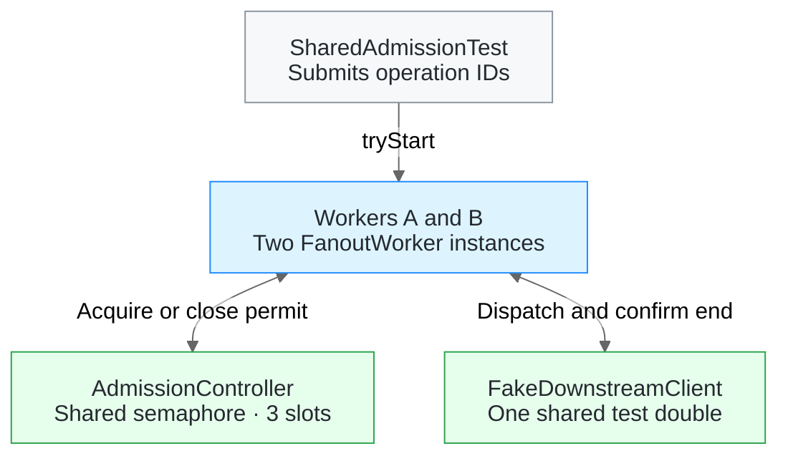

# Worker architecture

The first checkpoint exercises two logical workers in one Java 25 process. Both workers share a single admission controller and a simulated downstream. The test configures three slots for the entire pool.

## Components

| Component | Responsibility |
| --- | --- |
| [`OperationId`][operation] | Identifies work by firm, engagement, publication and engagement revision. The same logical work can reuse the ID across workers and attempts. |
| [`FanoutWorker`][worker] | Acquires a permit before dispatch, passes its operation ID to the downstream and closes the permit when execution reaches a confirmed terminal state. |
| [`AdmissionController`][admission] and [`InMemoryAdmissionController`][memory] | Define and implement atomic admission. The in-memory implementation uses a semaphore and returns an empty result immediately when every slot is reserved. |
| [`Permit`][permit] | Represents a reservation for one operation. Its first `close()` returns the slot to the pool. Repeated calls have no effect. |
| [`DownstreamClient`][downstream] | Dispatches an admitted operation and returns a `CompletionStage`. Success or failure on that stage means the downstream confirmed that execution ended or never started. |
| [`FakeDownstreamClient`][fake] | Test implementation that keeps operations active until the test finishes them explicitly. It records both the current and peak number of active operations. |
| [`SharedAdmissionTest`][test] | Creates two workers with the same dependencies, makes them compete for the last slot and verifies that the peak is three. It also verifies slot retention after a caller timeout. |
| [`TemplateFanoutWorkerApplication`][boot] | Starts Spring Boot 4.1.2. The test constructs the two-worker setup directly. |

## Operation lifecycle

1. A caller invokes `tryStart(operationId)`. If all slots are reserved, the worker returns `Optional.empty()` without dispatching anything. The caller can retry with the same ID.
2. If admitted, the worker calls `DownstreamClient.start` and registers `Permit.close()` on the terminal stage. A synchronous dispatch failure also closes the permit because the downstream contract guarantees that this call started no work.
3. The caller gets a separate `CompletableFuture`. A timeout or cancellation on that future ends the caller's wait while the downstream operation can continue to occupy its slot.
4. When the downstream confirms a terminal outcome, the worker closes the permit. The next attempt from either worker can claim the freed slot.

The timeout test starts three operations, times out the caller's future for one of them and checks that both workers are denied a fourth start. Once the fake finishes the original operation, the fourth can start and the peak stays at three.

The semaphore shares capacity within a single JVM. A deployment with separate worker processes needs a shared admission authority. A real downstream client must reconcile an ambiguous transport timeout by operation ID before reporting a terminal outcome. See the [system architecture](architecture.pdf) for the broader design.

## Durable publication planning

[`PublicationFanout`][planner] asks an [`EngagementSource`][source] for one bounded page of eligible engagements at a time. The source keeps each publication's membership, revisions and cursor order stable across restarts. The planner converts each engagement to the same `OperationId` used for downstream execution.

[`PostgresFanoutStore`][store] commits the page in a single transaction.

1. Check that the publication's stored cursor and page count still match the ones used to read the page. Stage the next cursor, or mark planning complete for the final page.
2. Insert the jobs into `fanout_job`. Its primary key is the four fields of `OperationId`. A repeated key leaves the existing job intact.
3. Commit the jobs and the update to `fanout_checkpoint` together. If any job insert fails, PostgreSQL rolls back the entire page. If another planner moved the checkpoint, the caller reads it again before planning another page.

After an interruption, a new planner resumes from the last committed cursor. Replaying a fully planned publication returns immediately. Planning records jobs for downstream execution, which continues to use the separate admission and worker contracts above.

[operation]: ../src/main/java/io/github/luisfm44/caseware/worker/OperationId.java
[worker]: ../src/main/java/io/github/luisfm44/caseware/worker/FanoutWorker.java
[admission]: ../src/main/java/io/github/luisfm44/caseware/worker/AdmissionController.java
[memory]: ../src/main/java/io/github/luisfm44/caseware/worker/InMemoryAdmissionController.java
[permit]: ../src/main/java/io/github/luisfm44/caseware/worker/Permit.java
[downstream]: ../src/main/java/io/github/luisfm44/caseware/worker/DownstreamClient.java
[fake]: ../src/test/java/io/github/luisfm44/caseware/worker/FakeDownstreamClient.java
[test]: ../src/test/java/io/github/luisfm44/caseware/worker/SharedAdmissionTest.java
[boot]: ../src/main/java/io/github/luisfm44/caseware/worker/TemplateFanoutWorkerApplication.java
[planner]: ../src/main/java/io/github/luisfm44/caseware/worker/planning/PublicationFanout.java
[source]: ../src/main/java/io/github/luisfm44/caseware/worker/planning/EngagementSource.java
[store]: ../src/main/java/io/github/luisfm44/caseware/worker/planning/PostgresFanoutStore.java
