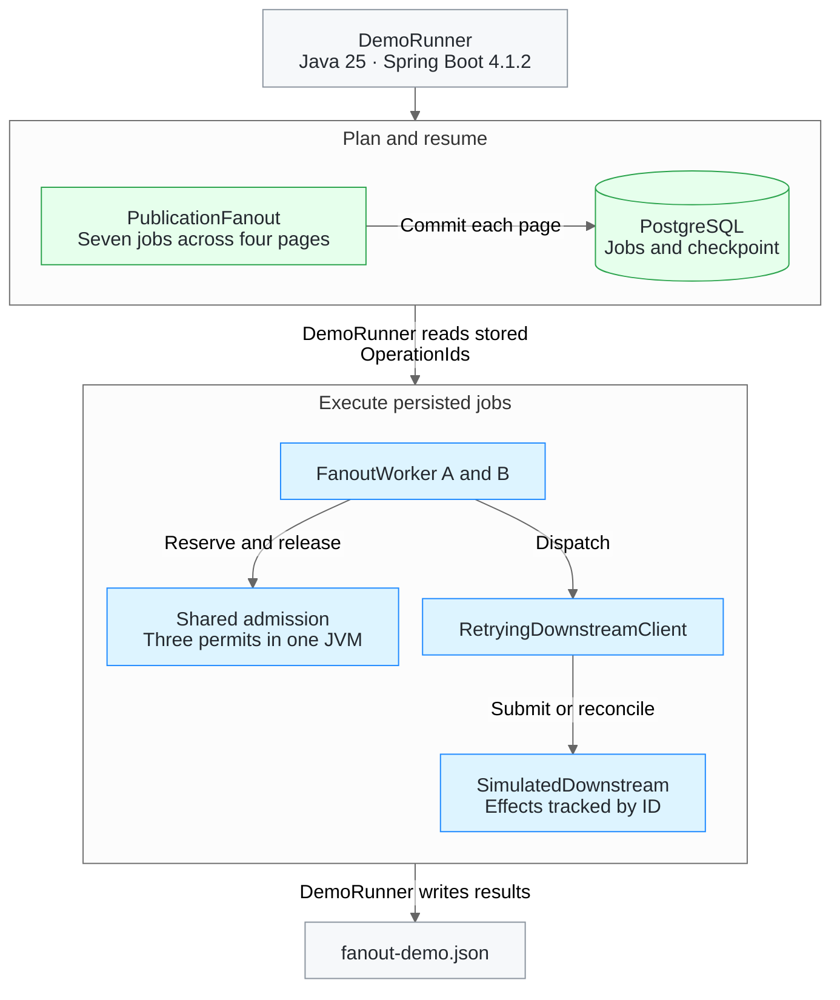
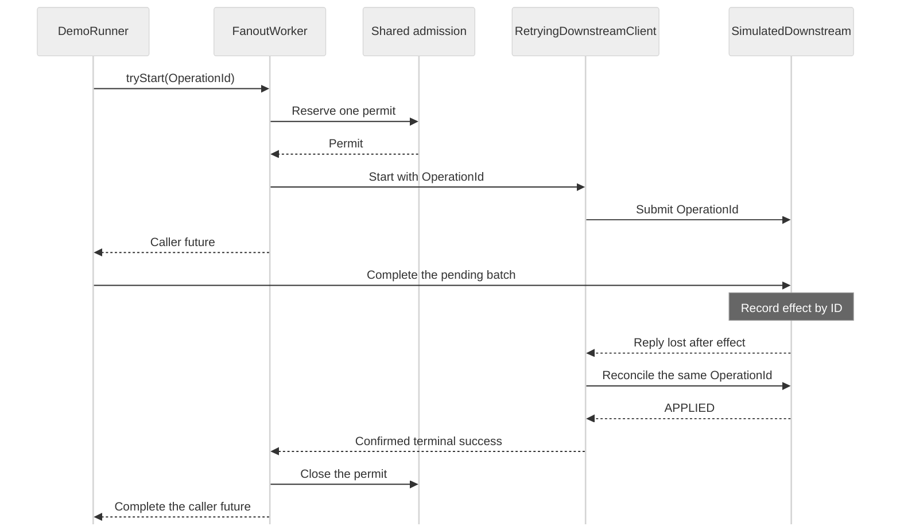

# Worker architecture

The Java 25 application runs the sample with Spring Boot 4.1.2 and the `demo` profile. `DemoRunner` connects publication planning in PostgreSQL to two logical workers that share three downstream slots in one JVM.

The demo consumes its own stored job IDs in a disposable schema. The separate `postgres-worker` profile claims planned jobs and coordinates slots across JVMs in PostgreSQL. Each fresh claim reserves a slot and advances the shared firm rotation in the same transaction. It reconciles uncertain attempts against an HTTP downstream. The process integration test exercises the protocol with a controlled server. Regional integration requires an engagement manager that supplies authoritative status and enforces idempotency and the real pool limit. [Proposed regional architecture](system-architecture.md) · [Worker design decisions](worker-design.md)

## Package structure

`TemplateFanoutWorkerApplication` is in the root package. Spring Boot scans the profile runners below it.

| Package | Responsibility |
| --- | --- |
| `planning` | Plans publications and defines the engagement source and fan-out store contracts. |
| `execution.model`, `execution.admission` | Hold the operation identity and capacity reservation contracts. |
| `execution.service`, `execution.port`, `execution.retry` | Orchestrate execution, define job queue and downstream contracts, and implement retries. |
| `adapter.postgres`, `adapter.http`, `adapter.memory` | Implement those contracts with JDBC, HTTP and the in-memory semaphore. |
| `bootstrap`, `demo` | Wire the `postgres-worker` profile and run the self-contained `demo` profile. |

`OperationId` is an immutable value object shared by planning and execution. The HTTP adapter maps its fields to the wire format. `Permit` represents a slot with an explicit release lifecycle.

## Components

| Component | Responsibility |
| --- | --- |
| [`OperationId`][operation] | Identifies work by firm, engagement, publication and engagement revision. The same logical work can reuse the ID across workers and attempts. |
| [`FanoutWorker`][worker] | Acquires a permit before dispatch, passes its operation ID to the downstream and closes the permit when execution reaches a confirmed terminal state. |
| [`AdmissionControl`][admission] and [`InMemoryAdmissionControl`][memory] | Define and implement atomic admission. The in-memory implementation uses a semaphore and returns an empty result immediately when every slot is reserved. |
| [`Permit`][permit] | Represents a reservation for one operation. Its first `close()` returns the slot to the pool. Repeated calls have no effect. |
| [`DownstreamClient`][downstream] | Dispatches an admitted operation and returns a `CompletionStage`. Success or failure on that stage means the downstream confirmed that execution ended or never started. |
| [`FakeDownstreamClient`][fake] | Test implementation that keeps operations active until the test finishes them explicitly. It records both the current and peak number of active operations. |
| [`SharedAdmissionTest`][test] | Creates two workers with the same dependencies, makes them compete for the last slot and verifies that the peak is three. It also verifies slot retention after a caller timeout. |
| [`PublicationFanout`][planner] and [`EngagementSource`][source] | Read bounded, stable pages of eligible engagements and produce job IDs. |
| [`PostgresFanoutStore`][store] | Persists each page's jobs and checkpoint in one transaction. |
| [`RetryingDownstreamClient`][retry] and [`DownstreamTransport`][transport] | Apply the retry policy and submit or reconcile a downstream operation by ID. |
| [`TemplateFanoutWorkerApplication`][boot] | Starts Spring Boot 4.1.2 and discovers the runner for the selected profile. |
| [`DurableWorkerRunner`][durable-runner] and [`DurableWorker`][durable-worker] | The runner wires the durable profile. The worker uses the job queue and downstream contracts to dispatch and reconcile attempts. |
| [`DemoRunner`][demo] | Plans and reads the sample publication in PostgreSQL, runs two logical workers and writes the JSON report. |
| [`SimulatedDownstream`][simulator] | Controls when replies arrive, records effects by operation ID and loses one reply after applying its effect. |

## Operation lifecycle

1. A caller invokes `tryStart(operationId)`. If all slots are reserved, the worker returns `Optional.empty()` without dispatching anything. The caller can retry with the same ID.
2. If admitted, the worker calls `DownstreamClient.start` and registers `Permit.close()` on the terminal stage. A synchronous dispatch failure also closes the permit because the downstream contract guarantees that this call started no work.
3. The caller gets a separate `CompletableFuture`. A timeout or cancellation on that future ends the caller's wait while the downstream operation can continue to occupy its slot.
4. When the downstream confirms a terminal outcome, the worker closes the permit. The next attempt from either worker can claim the freed slot.

The timeout test starts three operations, times out the caller's future for one of them and checks that both workers are denied a fourth start. Once the fake finishes the original operation, the fourth can start and the peak stays at three.

The semaphore shares capacity within a single JVM. A deployment with separate worker processes needs a shared admission authority. A real downstream client must reconcile an ambiguous transport timeout by operation ID before reporting a terminal outcome. See the [system architecture](architecture.pdf) for the broader design.

## Durable publication planning

[`PublicationFanout`][planner] asks an [`EngagementSource`][source] for the first bounded page of eligible engagements and its snapshot ID. The planner converts each engagement to the same `OperationId` used for downstream execution. Subsequent requests send the snapshot ID and cursor read from the checkpoint.

[`PostgresFanoutStore`][store] commits the page in a single transaction.

1. Pin the first page's snapshot ID. For later pages, check that the stored snapshot, cursor and page count still match the checkpoint used to read the page.
2. Insert the jobs into `fanout_job`. Its primary key is the four fields of `OperationId`. Replaying an operation key preserves its execution state.
3. Commit the jobs and checkpoint together. The checkpoint stores the snapshot ID, next cursor and page count. A final page marks the checkpoint complete. A failed job insert rolls back the entire page.

If two planners read different initial snapshots, the first successful commit pins the snapshot. The other planner reloads the committed checkpoint and uses its snapshot and cursor on the next request. A fresh process resumes the same way after an interruption. An unavailable snapshot or a response for a different snapshot stops planning before the next commit. Replaying a completed publication returns immediately. [Snapshot contract and legacy checkpoints](worker-design.md#engagement-snapshots)

## Downstream retries and reconciliation

[`RetryingDownstreamClient`][retry] implements `DownstreamClient` and uses the same `OperationId` for every submission and lookup. `FanoutWorker` keeps the permit reserved across dispatch, backoff and reconciliation until the terminal stage completes.

| Downstream outcome | Worker behavior |
| --- | --- |
| Applied | Complete successfully and release the permit. |
| Throttled or confirmed transient failure | Retry if the attempt had no effect and can no longer execute. Use exponential backoff with jitter and wait at least as long as the downstream's `Retry-After` hint. |
| Timeout or lost reply | Ask the [transport][transport] to reconcile the original operation by ID. Confirmed success completes the operation without another submission. A retry requires confirmation that the earlier attempt had no effect and can no longer execute. |
| Permanent rejection | Return a terminal failure and release the permit. |

Each execution allows three submissions, including the initial attempt. A confirmed rejection or exhausted retry budget produces a [`DownstreamFailure`][failure] with the reason, submission count and last submission outcome. An unresolved lookup keeps the terminal stage pending, so a caller timeout cannot free the slot or cause a second dispatch.

The transport must supply authoritative status and use the operation ID as its idempotency key. The controlled test transport records applied effects and can lose a reply after recording an effect. The worker then reconciles by ID, and the test verifies one submission and one effect. The retry counter is scoped to a worker execution.

### Recovering a lost reply

The status lookup completes the original operation. If the lookup cannot confirm the outcome, the worker keeps the slot reserved until the downstream reports a terminal state.

## Executable demo

1. The runner creates a disposable PostgreSQL schema. It plans the first page of a seven-engagement publication and creates a fresh planner to resume from its committed checkpoint.
2. After planning finishes in four pages, the runner reads the stored job IDs. It alternates submissions between two workers until their shared pool of three slots is full.
3. The simulator completes a batch and applies each effect once. For one job it loses the reply after applying the effect. The client confirms the result by operation ID without resubmitting.
4. The runner checks the report totals, removes the demo schema and writes the JSON report. [Run the demo](../README.md#postgresql-integration-tests-and-executable-demo)

## Verification

- [`SharedAdmissionTest`][test] measures the downstream concurrency peak and verifies permit retention after a caller timeout.
- [`PublicationFanoutIT`][planning-test] runs against PostgreSQL and checks resume, replay, rollback and stale checkpoints.
- [`RetryingDownstreamClientTest`][retry-test] checks the single-effect recovery, bounded retries and rejection paths with controlled responses.
- The [manual demo workflow](../.github/workflows/demo.yml) builds and runs the packaged JAR against PostgreSQL, checks the report and uploads it as a workflow artifact.
- The [SonarQube quality job](code-quality.md) verifies zero missed JaCoCo lines and branches, imports the combined unit and PostgreSQL coverage, and enforces the 100% overall gate. GitHub Actions publishes both reports on pushes to `main` and on manual runs.

See the [worker design decisions](worker-design.md) for the rationale and how the current implementation maps to the system proposal.

[operation]: ../src/main/java/io/github/luisfm44/caseware/worker/execution/model/OperationId.java
[worker]: ../src/main/java/io/github/luisfm44/caseware/worker/execution/service/FanoutWorker.java
[admission]: ../src/main/java/io/github/luisfm44/caseware/worker/execution/admission/AdmissionControl.java
[memory]: ../src/main/java/io/github/luisfm44/caseware/worker/adapter/memory/InMemoryAdmissionControl.java
[permit]: ../src/main/java/io/github/luisfm44/caseware/worker/execution/admission/Permit.java
[downstream]: ../src/main/java/io/github/luisfm44/caseware/worker/execution/port/DownstreamClient.java
[fake]: ../src/test/java/io/github/luisfm44/caseware/worker/execution/admission/FakeDownstreamClient.java
[test]: ../src/test/java/io/github/luisfm44/caseware/worker/execution/admission/SharedAdmissionTest.java
[boot]: ../src/main/java/io/github/luisfm44/caseware/worker/TemplateFanoutWorkerApplication.java
[planner]: ../src/main/java/io/github/luisfm44/caseware/worker/planning/PublicationFanout.java
[source]: ../src/main/java/io/github/luisfm44/caseware/worker/planning/EngagementSource.java
[store]: ../src/main/java/io/github/luisfm44/caseware/worker/adapter/postgres/PostgresFanoutStore.java
[retry]: ../src/main/java/io/github/luisfm44/caseware/worker/execution/retry/RetryingDownstreamClient.java
[transport]: ../src/main/java/io/github/luisfm44/caseware/worker/execution/port/DownstreamTransport.java
[failure]: ../src/main/java/io/github/luisfm44/caseware/worker/execution/retry/DownstreamFailure.java
[planning-test]: ../src/test/java/io/github/luisfm44/caseware/worker/planning/PublicationFanoutIT.java
[retry-test]: ../src/test/java/io/github/luisfm44/caseware/worker/execution/retry/RetryingDownstreamClientTest.java
[durable-runner]: ../src/main/java/io/github/luisfm44/caseware/worker/bootstrap/DurableWorkerRunner.java
[durable-worker]: ../src/main/java/io/github/luisfm44/caseware/worker/execution/service/DurableWorker.java
[demo]: ../src/main/java/io/github/luisfm44/caseware/worker/demo/DemoRunner.java
[simulator]: ../src/main/java/io/github/luisfm44/caseware/worker/demo/SimulatedDownstream.java
