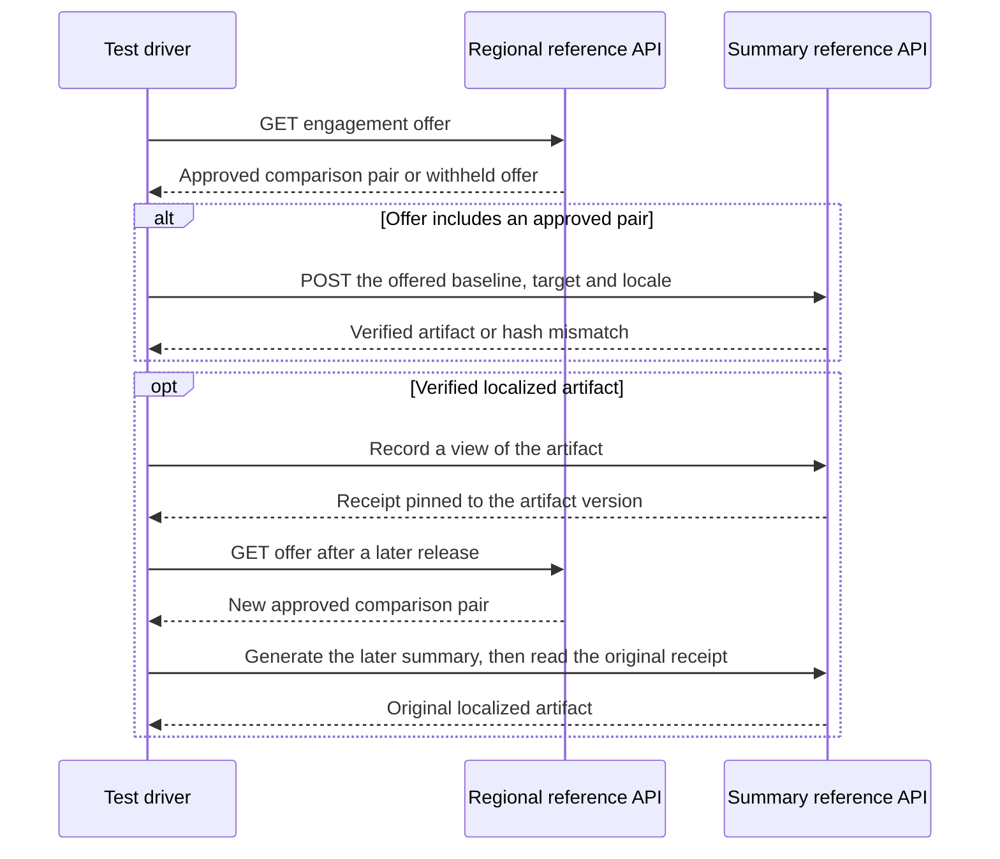

# Connected reference APIs

This test-only module starts the repository's regional version-selection and summary validation Spring Boot applications on separate loopback ports. A test driver sends real HTTP requests to both. It reads the regional offer and forwards the exact comparison pair to summary validation. Each application uses controlled fixtures for its dependencies.



| Scenario | Expected evidence |
| --- | --- |
| Exact pair and localized receipt | The regional API offers v4 → v7. The summary API verifies both approved SHA-256 hashes, reports changes C17 and C18, and omits the temporary v5 field. After the regional API offers v4 → v8 and a later summary is generated, the original receipt still returns the exact v7 artifact in French Canadian. |
| Withheld offer | The regional API returns no comparison pair. A filter on the summary server confirms zero generation requests. The summary catalog is untouched. |
| Changed approved bytes | The regional API offers v4 → v7. The summary API detects changed v7 bytes, returns HTTP 422 and publishes no artifact. The grouping fixture is untouched. |

## Run locally

With Java 25, run all standalone and connected reference tests from the repository root.

```bash
./mvnw -f examples/pom.xml -DfailIfNoTests=true clean test
```

To run the connected suite only, build its two reactor dependencies and select the connected HTTP test.

```bash
./mvnw -f examples/pom.xml -pl connected-reference-apis -am \
  -Dtest=ConnectedReferenceApisHttpTest -Dsurefire.failIfNoSpecifiedTests=false clean test
```

Generate the same HTML evidence as CI.

```bash
python3 examples/regional-version-selection/tools/render_evidence.py \
  examples/connected-reference-apis/target/surefire-reports/TEST-io.github.luisfm44.caseware.connected.ConnectedReferenceApisHttpTest.xml \
  examples/connected-reference-apis/target/evidence \
  --manifest examples/connected-reference-apis/report-scenarios.json
```

Open `examples/connected-reference-apis/target/evidence/index.html`. The [Connected reference APIs workflow](../../.github/workflows/connected-reference-apis.yml) uploads the HTML and Surefire XML as the `connected-reference-apis` artifact.

## Scope of the evidence

The test driver models a caller connecting the two references. The regional catalog, engagement manager, artifact source and grouping provider are fixtures. The archive and its receipt remain in the summary reference's memory for the test. Production service-to-service calls, durable recovery and regional queue behavior would require deployment-specific validation. [Acceptance criteria](../../docs/owner-acceptance.md) · [Proposed regional verification](../../docs/regional-verification.md)
